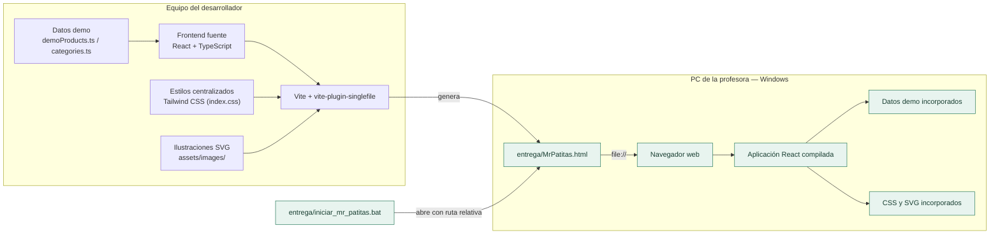

# Mr. Patitas — Primera Entrega Funcional (MVP)

Catálogo virtual especializado en productos para **perros y gatos**, desarrollado como proyecto académico de Ingeniería de Software (*Software en Equipo* — metodología **TSPi**) en la **Institución Universitaria Politécnico Grancolombiano**.

> **Alcance de esta entrega (MVP):** Esta primera versión demostrativa prioriza la interfaz web moderna y adaptable (escritorio y móvil), la presentación de **6 productos de demostración** y la distribución autónoma para Windows mediante un único archivo HTML (`entrega/MrPatitas.html`), sin requerir instalaciones ni conexión a Internet por parte de la docente. No representa todavía la arquitectura Full-Stack de futuras entregas.

---

## 1. Arquitectura del MVP — Primera entrega

### 1.1 Resumen arquitectónico

Mr. Patitas se desarrolla en `frontend/` con **React, TypeScript, Vite y Tailwind CSS**. Durante el desarrollo, **Node.js y npm** se utilizan exclusivamente en el equipo del desarrollador para instalar dependencias, ejecutar el servidor local de Vite y compilar la aplicación.

Al compilar (`npm --prefix frontend run build`), Vite junto con **`vite-plugin-singlefile`** genera el archivo autónomo **`entrega/MrPatitas.html`**, integrando dentro de un solo archivo el JavaScript compilado, los estilos CSS, los datos de demostración y las 6 ilustraciones SVG. La docente abre la aplicación directamente en su navegador de Windows mediante **`entrega/iniciar_mr_patitas.bat`** (protocolo `file://`), sin instalar Node.js, npm, VS Code, backend, base de datos ni requerir conexión a Internet.

### 1.2 Diagrama de arquitectura del MVP

Vista de componentes y despliegue correspondiente únicamente a esta primera entrega. El diagrama fuente en PlantUML se encuentra en [`docs/arquitectura/Arquitectura_MVP_Mr_Patitas.puml`](docs/arquitectura/Arquitectura_MVP_Mr_Patitas.puml).



### 1.3 Componentes incluidos y responsabilidades

- **Interfaz React (`frontend/src/components/`):** encabezado con navegación responsive (`Header.tsx`), logotipo reutilizable (`BrandIcon.tsx`), sección principal de bienvenida (`Hero.tsx`), categorías visuales (`CategoryStrip.tsx`), catálogo y tarjetas de producto (`ProductCatalog.tsx`, `ProductCard.tsx`) y pie de página (`Footer.tsx`).
- **Datos de demostración (`frontend/src/data/`):** 6 productos iniciales en `demoProducts.ts`, categorías visuales en `categories.ts` y enlaces/textos globales en `siteConfig.ts`, integrados en el bundle al compilar.
- **Estilos centralizados (`frontend/src/index.css`):** Tailwind CSS v4 con tokens `@theme` para colores y tipografía del sistema (sin fuentes CDN), compilado e incrustado en el HTML final.
- **Recursos gráficos (`frontend/src/assets/images/`):** 6 ilustraciones SVG locales registradas en `index.ts` e incrustadas como `data:image/svg+xml` dentro de `MrPatitas.html`.
- **Compilación autónoma (`frontend/vite.config.ts`):** empaquetado mediante Vite y `vite-plugin-singlefile` con copia automática hacia `entrega/MrPatitas.html`.
- **Lanzador Windows (`entrega/iniciar_mr_patitas.bat`):** comprueba que `MrPatitas.html` exista en la misma carpeta y lo abre en el navegador predeterminado.

### 1.4 Separación entre entorno de desarrollo y entorno de ejecución

| Elemento | PC del desarrollador | PC de la profesora (Windows) |
| :--- | :--- | :--- |
| Node.js y npm | Sí, para instalar dependencias, desarrollar y compilar | **No** |
| React, TypeScript, Vite y Tailwind CSS | Dependencias de desarrollo en `frontend/` | **No** se instalan |
| `entrega/MrPatitas.html` | Se genera automáticamente con `npm run build` | Se abre directamente en el navegador (`file://`) |
| `entrega/iniciar_mr_patitas.bat` | Se prueba antes de entregar | Se ejecuta con doble clic |
| Backend / API REST | No incluido en este MVP | **No** |
| Base de datos | No incluida en este MVP | **No** |
| Conexión a Internet | Solo necesaria al ejecutar `npm install` por primera vez | **No** se requiere para usar la aplicación |

### 1.5 Tecnologías de esta entrega

- **Desarrollo (`frontend/`):** React, TypeScript, Vite, Tailwind CSS v4 y `vite-plugin-singlefile`.
- **Distribución (`entrega/`):** archivo HTML autónomo (`MrPatitas.html`) + lanzador Windows nativo (`iniciar_mr_patitas.bat`).

### 1.6 Criterios de aceptación técnica del MVP

| # | Criterio | Estado comprobado |
| :-: | :--- | :--- |
| 1 | `MrPatitas.html` se genera correctamente mediante el proceso de build (`tsc -b && vite build`). | **Comprobado** (build sin errores en entorno de desarrollo). |
| 2 | `MrPatitas.html` se abre directamente mediante `file://`, sin servidor local. | **Comprobado** (verificación de DOM renderizado en Chrome headless vía `file://`). |
| 3 | Los 6 productos y sus 6 ilustraciones SVG se muestran sin conexión a Internet. | **Comprobado** (6 artículos y 6 `data:image/svg+xml` renderizados sin red). |
| 4 | No existen dependencias externas en ejecución, CDN ni solicitudes `fetch()` a archivos locales. | **Comprobado** (`0` scripts/hojas externas y `0` llamadas `fetch()` en `frontend/src/`). |
| 5 | `iniciar_mr_patitas.bat` abre el HTML con ruta relativa (`%~dp0`) y funciona al copiar `entrega/` a otra ubicación con espacios. | **Comprobado** (código de salida `0` en `entrega/` y en copia con espacios; código `1` con aviso claro si falta el HTML). |
| 6 | El diseño funciona en tamaños de pantalla de escritorio y móvil. | **Comprobado** (capturas e inspección visual en escritorio `1280px` y móvil `500px`). |

> *Nota de transparencia:* Las comprobaciones anteriores se ejecutaron en el equipo de desarrollo (usando Google Chrome headless y consola de Windows). La verificación interactiva final en el equipo Windows de la docente queda pendiente hasta el momento de la entrega.

---

## 2. Estructura de distribución y ejecución directa (sin instalaciones)

La carpeta lista para copiar y entregar es **`entrega/`**:

```text
entrega/
├── iniciar_mr_patitas.bat
├── MrPatitas.html
└── LEEME.txt
```

### Requisitos de ejecución (usuario final / docente)
- Windows con un navegador moderno (Microsoft Edge, Google Chrome o Mozilla Firefox).
- **No requiere instalar** Node.js, npm, PostgreSQL, Visual Studio Code, Python, servidores locales ni dependencias adicionales.
- **No requiere conexión a Internet.**

### Pasos para abrir la aplicación
1. Copie la carpeta `entrega/` completa a cualquier ubicación de Windows (incluso si la ruta contiene espacios).
2. Haga doble clic sobre **`entrega/iniciar_mr_patitas.bat`**.
3. El script verificará que exista `MrPatitas.html` en la misma carpeta y abrirá la página automáticamente en el navegador predeterminado.
4. *(Alternativa)* También puede abrir `entrega/MrPatitas.html` directamente con doble clic desde el Explorador de Windows (`file://`).

### Cómo funciona `entrega/iniciar_mr_patitas.bat`
1. `@echo off` y `setlocal` ocultan el eco de comandos y aíslan las variables temporales.
2. `chcp 65001 >nul` configura UTF-8 en la consola para mostrar avisos claros en español.
3. `set "HTML_FILE=%~dp0MrPatitas.html"` resuelve la ruta relativa al propio archivo `.bat` mediante **`%~dp0`**, permitiendo mover o copiar la carpeta `entrega/` a rutas con espacios sin modificar nada.
4. `if not exist "%HTML_FILE%"` valida la existencia del HTML; si falta, muestra un error comprensible, ejecuta `pause` y termina con código `1`.
5. `start "" "%HTML_FILE%"` abre el archivo directamente en el navegador predeterminado; el navegador ejecuta el JavaScript ya incrustado sin levantar servidores locales.

---

## 3. Guía de desarrollo y mantenimiento

### 3.1 Requisitos previos (solo equipo de desarrollo)
- **Node.js** y **npm** instalados (verificado en desarrollo con Node.js `v26.13.1` y npm `11.20.0`).
- **Visual Studio Code** (recomendado).

### 3.2 Cómo abrir el proyecto en VS Code
1. Abra **Visual Studio Code**.
2. Seleccione **Archivo → Abrir carpeta...** y elija la carpeta raíz `Mr.Patitas`.
3. Abra la terminal integrada (`Ctrl + ñ` o **Terminal → Nueva terminal**).
4. Si es la primera vez en ese equipo, instale las dependencias de desarrollo:

```powershell
npm --prefix frontend install
```

### 3.3 Cómo iniciar el modo de desarrollo con Vite
```powershell
npm --prefix frontend run dev
```

Vite mostrará una URL local (habitualmente `http://localhost:5173`) con recarga automática al guardar cambios en `frontend/src/`. Presione `Ctrl + C` para detener el servidor.

### 3.4 Cómo modificar o agregar productos y categorías
- **Productos (`frontend/src/data/demoProducts.ts`):** edite nombres, descripciones, precios demo, stock demo o agregue nuevos objetos al arreglo `DEMO_PRODUCTS`. Los contadores totales, por especie y por categoría se actualizan automáticamente sin modificar `ProductCard.tsx`, `Hero.tsx`, `CategoryStrip.tsx` ni `ProductCatalog.tsx`.
- **Categorías (`frontend/src/data/categories.ts`):** renombre, quite o agregue categorías eligiendo uno de los íconos disponibles (`'bowl'`, `'leash'`, `'bed'`, `'toy'`, `'hygiene'`, `'tag'`). Asegúrese de que el campo `category` de cada producto coincida con el `name` definido allí.
- **Navegación y textos globales (`frontend/src/data/siteConfig.ts`):** centraliza `NAV_LINKS` y los textos compartidos entre encabezado y pie de página.

### 3.5 Cómo reemplazar o agregar imágenes
1. Coloque el archivo (preferiblemente `.svg` liviano) dentro de **`frontend/src/assets/images/`**.
2. Para reemplazar una ilustración existente sin tocar código, sobrescriba el archivo conservando el mismo nombre.
3. Para agregar una imagen nueva, impórtela en **`frontend/src/assets/images/index.ts`** (`PRODUCT_IMAGES`) y asígnela en `imageSrc` dentro de `frontend/src/data/demoProducts.ts` con un texto `imageAlt` descriptivo (`RNF03`).
4. **No utilice enlaces externos (`https://...`) ni `fetch()`**: al importarse como módulos locales, Vite las incrusta automáticamente dentro de `entrega/MrPatitas.html`.

### 3.6 Cómo cambiar colores y tipografías
Toda la paleta de marca y la fuente base están centralizadas en el bloque `@theme` de **`frontend/src/index.css`**:

- `--color-brand-primary` (`#d96b27`) y `--color-brand-primary-hover` (`#c2591a`)
- `--color-brand-secondary` (`#1e4d4f`)
- `--color-surface-canvas` (`#faf8f5`) y `--color-surface-muted` (`#f5f1eb`)
- `--color-hero-from` (`#fff9f2`) y `--color-hero-to` (`#eef6f4`)
- `--font-sans` (tipografía del sistema sin fuentes CDN)

### 3.7 Cómo compilar una nueva versión autónoma
```powershell
npm --prefix frontend run build
```

Ejecuta `tsc -b`, compila el HTML único con `vite-plugin-singlefile` en `frontend/dist/index.html` y actualiza automáticamente **`entrega/MrPatitas.html`**.

### 3.8 Cómo probar la carpeta `entrega/` antes de enviarla
1. Haga doble clic en `entrega/iniciar_mr_patitas.bat` y verifique los 6 productos y sus ilustraciones.
2. Copie `entrega/` a otra ubicación con espacios en el nombre (por ejemplo `Escritorio\Prueba Entrega Mr Patitas\entrega`) y repita la ejecución del `.bat`.
3. Compruebe en el navegador que la barra de direcciones inicie con `file:///` y que no haya errores en la consola (`F12 → Consola`).
4. Verifique la vista escritorio (`1280px`) y móvil (`390px`) con `Ctrl + Shift + M`, incluyendo el menú hamburguesa.

---

## 4. Productos de demostración (datos de prueba)

Esta primera entrega incluye **6 productos ficticios de demostración** (3 para perros y 3 para gatos), basados en la tabla de ejemplos de `docs/fuentes/EntregaMrPatitas.docx` (pág. 7):

| ID | Producto (demo) | Especie | Categoría | Precio demo (COP) | Stock demo |
| :--- | :--- | :---: | :--- | :---: | :---: |
| `DEMO-01` | Alimento seco para gato | Gato | Alimentación | $ 48.900 | 14 |
| `DEMO-02` | Snacks naturales para perro | Perro | Alimentación | $ 18.500 | 22 |
| `DEMO-03` | Correa resistente para perro | Perro | Paseo | $ 34.000 | 9 |
| `DEMO-04` | Cama acolchada para perro | Perro | Descanso | $ 115.000 | 6 |
| `DEMO-05` | Rascador compacto para gato | Gato | Juguetes | $ 79.900 | 8 |
| `DEMO-06` | Cepillo suave para gato | Gato | Higiene | $ 26.500 | 17 |

> **Aclaración importante:** Los precios, descripciones y existencias son **datos de prueba** y **no representan inventario comercial real**. El catálogo demostrativo de 6 artículos **no satisface todavía `RF06`** (mínimo 20 artículos).

---

## 5. Estado de los requisitos originales (`EntregaMrPatitas.docx`)

Se conservan íntegramente `RF01–RF13`, `RNF01–RNF07` y `CP01–CP12` del documento fuente, clasificados según su estado real en esta primera entrega.

### Requisitos funcionales (`RF01–RF13`)

| Código | Requisito original | Estado en esta entrega (MVP) | Observación |
| :--- | :--- | :--- | :--- |
| **RF01** | El cliente debe poder registrarse para crear una cuenta. | Pendiente para futuras entregas | Aplazado a iteración con backend y autenticación real. |
| **RF02** | El sistema debe permitir iniciar y cerrar sesión. | Pendiente para futuras entregas | Aplazado a iteración con backend y sesiones seguras. |
| **RF03** | Solo un cliente autenticado puede iniciar el proceso de pedido. | Pendiente para futuras entregas | Aplazado junto con autenticación y flujo de pedidos. |
| **RF04** | El cliente debe poder buscar artículos por nombre. | Pendiente para futuras entregas | Aplazado a iteración del motor de búsqueda. |
| **RF05** | El cliente debe poder filtrar productos por características definidas. | Pendiente para futuras entregas | Aplazado a iteración de búsqueda avanzada. |
| **RF06** | El catálogo debe mostrar al menos 20 artículos. | Implementado parcialmente | **6 productos de demostración no satisfacen todavía RF06** (exige mínimo 20 artículos). |
| **RF07** | Cada artículo debe mostrar imagen, nombre, características, precio y stock. | Implementado parcialmente | Implementado con 6 artículos y datos ficticios de prueba; falta conectar a catálogo ≥ 20 y persistencia. |
| **RF08** | Al seleccionar la imagen o detalle se debe ampliar la descripción del producto. | Pendiente para futuras entregas | Aplazado a próxima iteración (modal o vista ampliada). |
| **RF09** | El cliente debe seleccionar un artículo e indicar la cantidad. | Pendiente para futuras entregas | Aplazado a iteración de compra por artículo y carrito. |
| **RF10** | El sistema debe validar que la cantidad solicitada no supere el stock. | Pendiente para futuras entregas | Aplazado a validación transaccional de stock en servidor. |
| **RF11** | El carrito debe mostrar artículos, cantidades, precios y subtotales. | Pendiente para futuras entregas | Aplazado a iteración de carrito de compras. |
| **RF12** | El carrito debe calcular y actualizar el total de los artículos. | Pendiente para futuras entregas | Aplazado a iteración de carrito de compras. |
| **RF13** | El cliente debe poder modificar cantidades o retirar artículos del carrito. | Pendiente para futuras entregas | Aplazado a iteración de carrito de compras. |

### Requisitos no funcionales (`RNF01–RNF07`)

| Código | Requisito original | Estado en esta entrega (MVP) | Observación |
| :--- | :--- | :--- | :--- |
| **RNF01** | La interfaz debe ser intuitiva y consistente. | Implementado y verificado | Estructura visual clara con tokens `@theme` centralizados. |
| **RNF02** | El catálogo debe adaptarse a dispositivos móviles y de escritorio. | Implementado y verificado | Diseño responsive con Tailwind CSS verificado en escritorio y móvil. |
| **RNF03** | Las imágenes deben tener calidad y texto alternativo apropiados. | Implementado y verificado | 6 ilustraciones SVG integradas con atributos `alt` descriptivos. |
| **RNF04** | Las búsquedas y cálculos deben responder de manera clara y oportuna. | Pendiente para futuras entregas | Aplazado junto con motor de búsqueda, carrito y benchmarks. |
| **RNF05** | El código debe estar organizado y ser mantenible. | Implementado y verificado | Separación en `components/`, `data/`, `types/`, `assets/images/` y `index.css`. |
| **RNF06** | La autenticación debe gestionarse de forma segura si se implementa en producción. | Pendiente para futuras entregas | Aplazado a iteración de backend seguro. |
| **RNF07** | Los mensajes de error y confirmación deben ser comprensibles. | Implementado parcialmente | Mensajes claros en `iniciar_mr_patitas.bat` y avisos de datos de prueba; pendientes los flujos interactivos futuros. |

### Plan de pruebas original (`CP01–CP12`)

| ID | Prueba original | Estado en esta entrega (MVP) | Observación |
| :--- | :--- | :--- | :--- |
| **CP01** | Registro de cliente con datos válidos. | Pendiente para futuras entregas | Depende de RF01. |
| **CP02** | Inicio de sesión con credenciales válidas. | Pendiente para futuras entregas | Depende de RF02. |
| **CP03** | Intento de pedido sin iniciar sesión. | Pendiente para futuras entregas | Depende de RF03. |
| **CP04** | Búsqueda básica por nombre completo o parcial. | Pendiente para futuras entregas | Depende de RF04. |
| **CP05** | Búsqueda avanzada combinando filtros. | Pendiente para futuras entregas | Depende de RF05. |
| **CP06** | Revisión del catálogo (mínimo 20 artículos). | Implementado parcialmente | Se visualizan 6 productos de prueba; falta ampliar a ≥ 20 para aprobar CP06 completo. |
| **CP07** | Clic en imagen o detalle del producto. | Pendiente para futuras entregas | Depende de RF08. |
| **CP08** | Selección de artículo y cantidad válida. | Pendiente para futuras entregas | Depende de RF09. |
| **CP09** | Solicitud de cantidad superior al stock. | Pendiente para futuras entregas | Depende de RF10. |
| **CP10** | Revisión del carrito. | Pendiente para futuras entregas | Depende de RF11 y RF12. |
| **CP11** | Cambio de cantidad o retiro de artículo. | Pendiente para futuras entregas | Depende de RF13. |
| **CP12** | Visualización en móvil y escritorio. | Implementado y verificado | Verificado sobre `MrPatitas.html` abierto con `file://`. |

---

## 6. Arquitectura futura (no implementada en este MVP)

Los siguientes componentes **NO están implementados en esta primera entrega** ni forman parte del diagrama del MVP; quedan reservados como evolución arquitectónica para iteraciones posteriores cuando se apruebe su desarrollo:

- **Backend API REST:** Node.js LTS + TypeScript + **Fastify** (validación de esquemas, servicios desacoplados).
- **Persistencia y ORM:** **PostgreSQL** como fuente única de verdad junto con **Prisma o Drizzle ORM** (decisión por ratificar antes de iniciar la fase backend).
- **Seguridad y sesiones:** registro, inicio/cierre de sesión y autorización real en servidor.
- **Motor híbrido de búsqueda de 6 componentes:** `ProductHashTable`, `InvertedIndex`, `SetOperations`, `Trie`, `RankingEngine` y `RecommendationEngine`.
- **Flujo transaccional:** catálogo ampliado (≥ 20 artículos, `RF06`), vista ampliada de detalle (`RF08`), carrito de compras, validación transaccional de stock y pedidos.
- **Calidad y CI:** pruebas automatizadas (Vitest / Playwright), GitHub Actions y benchmarks reproducibles.

> La arquitectura Full-Stack futura se documentará en diagramas separados al aprobarse su implementación, sin mezclarla con la arquitectura autónoma vigente de esta entrega.

---

## 7. Estructura del repositorio y control de versiones

```text
Mr.Patitas/
├── entrega/                              # Paquete autónomo listo para entregar
│   ├── iniciar_mr_patitas.bat
│   ├── MrPatitas.html
│   └── LEEME.txt
├── frontend/                             # Código fuente del MVP (React + TS + Vite + Tailwind)
│   └── src/
│       ├── assets/images/                # Ilustraciones SVG y registro central (index.ts)
│       ├── components/                   # Componentes visuales separados y reutilizables
│       ├── data/                         # demoProducts.ts, categories.ts, siteConfig.ts
│       ├── types/                        # Contratos TypeScript
│       └── index.css                     # Tokens centralizados (@theme)
├── docs/
│   ├── arquitectura/
│   │   ├── Arquitectura_MVP_Mr_Patitas.puml   # Fuente PlantUML del MVP
│   │   └── Arquitectura_MVP_README.md         # Documento base de arquitectura del MVP
│   ├── fuentes/                          # Documentos originales intactos
│   └── prompts/                          # Prompt maestro intacto
├── backend/                              # Reservado para próximas entregas
├── tests/                                # Reservado para próximas entregas
├── scripts/                              # Reservado para próximas entregas
├── .gitignore                            # Excluye node_modules/, dist/, .env* y temporales
└── README.md
```

El repositorio Git local está inicializado en la rama `main` con `.gitignore` protegiendo dependencias (`node_modules/`), compilaciones temporales (`frontend/dist/`), secretos (`.env*`) y archivos temporales de Office.
