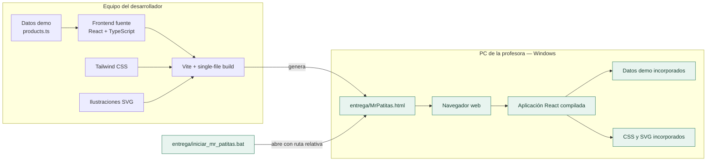

## Arquitectura del MVP — Primera entrega

> **Alcance de esta arquitectura:** primera entrega demostrativa de Mr. Patitas. Incluye una interfaz web, seis productos de demostración y distribución autónoma para Windows. No representa todavía la arquitectura Full-Stack futura.

### Resumen

Mr. Patitas se desarrolla con **React, TypeScript, Vite y Tailwind CSS**. Durante el desarrollo, Node.js y npm se utilizan en el equipo del desarrollador para instalar dependencias, ejecutar el servidor de desarrollo y compilar la aplicación.

Para la entrega se genera `entrega/MrPatitas.html` como un archivo HTML autónomo. El código JavaScript, los estilos CSS, los datos de demostración y los recursos visuales deben quedar incorporados en ese archivo. El usuario final abre la aplicación desde el navegador mediante `iniciar_mr_patitas.bat`; no necesita Node.js, npm, VS Code, Docker, backend, base de datos ni conexión a Internet.

### Diagrama de arquitectura

El siguiente diagrama es la vista de componentes y despliegue del MVP. El archivo fuente PlantUML se conserva en `docs/arquitectura/Arquitectura_MVP_Mr_Patitas.puml`.



### Separación entre desarrollo y ejecución

| Elemento | PC del desarrollador | PC de la profesora |
|---|---|---|
| Node.js y npm | Sí, para desarrollar y compilar | No |
| React, TypeScript, Vite y Tailwind | Dependencias de desarrollo | No se instalan |
| `MrPatitas.html` | Se genera al compilar | Se abre en el navegador |
| Archivo `.bat` | Se prueba antes de entregar | Se ejecuta con doble clic |
| Backend / API | No en este MVP | No |
| Base de datos | No en este MVP | No |
| Internet | No debería ser necesario para la aplicación final | No debería ser necesario para usarla |

### Estructura de distribución

```text
entrega/
├── iniciar_mr_patitas.bat
├── MrPatitas.html
└── LEEME.txt
```

El BAT debe localizar el HTML usando `%~dp0`, de modo que la carpeta `entrega` pueda copiarse a otra ubicación sin cambiar rutas. El BAT solo abre el HTML; el navegador ejecuta el JavaScript que ya está integrado en el archivo compilado. Esto es intencional y permite que la profesora no tenga que instalar un entorno de desarrollo.

### Componentes incluidos en el MVP

- **Interfaz React:** encabezado, sección de bienvenida, categorías visuales, tarjetas de producto y pie de página.
- **Datos de demostración:** seis productos iniciales definidos en un archivo TypeScript independiente antes de compilar.
- **Estilos:** Tailwind CSS compilado e incorporado al HTML.
- **Recursos gráficos:** ilustraciones locales SVG incorporadas al resultado final, sin depender de enlaces externos.
- **Lanzador Windows:** BAT que comprueba que `MrPatitas.html` exista y lo abre con el navegador predeterminado.

### Fuera del alcance de esta primera entrega

No forman parte de este MVP el backend Fastify, PostgreSQL, ORM, autenticación, pedidos, carrito, motor de búsqueda de seis componentes ni servicios externos. Se mantienen como posibles incrementos posteriores del proyecto. El catálogo de seis productos es demostrativo y **no satisface todavía el requisito global de al menos 20 artículos (RF06)**.

### Criterios de aceptación técnica

1. `MrPatitas.html` se genera mediante el proceso de build.
2. El HTML se abre directamente usando `file://`, sin servidor local.
3. Los seis productos y sus ilustraciones aparecen sin conexión a Internet.
4. No hay dependencias de ejecución externas, CDN ni solicitudes a archivos locales mediante `fetch()`.
5. El BAT abre el HTML mediante una ruta relativa y funciona después de copiar la carpeta a otra ubicación de Windows.
6. Se verifica el diseño en tamaños de pantalla de escritorio y móvil.

> Los criterios se marcarán como **validados** únicamente después de ejecutar y registrar las pruebas correspondientes.

---

## Arquitectura futura (no implementada en este MVP)

La arquitectura Full-Stack planteada para iteraciones posteriores se documentará en un diagrama separado cuando se apruebe su implementación. No se deben mezclar en el diagrama de este MVP tecnologías como Astro SSR, FastAPI, SQLite, almacenamiento S3/MinIO, Rust o Docker, porque no corresponden a la solución autónoma actualmente acordada.
