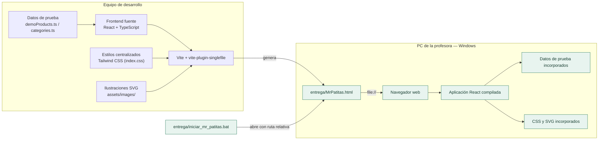

[← Volver al README principal](../../README.md)

# Arquitectura y Funcionamiento — Entrega 2 de 3

> **Alcance:** Este documento describe la arquitectura actual correspondiente a la **Entrega 2 de 3** de Mr. Patitas: interfaz web adaptable, 6 productos de prueba y distribución portable para Windows. Los componentes de backend, base de datos y motor de búsqueda se integran en la entrega final (3 de 3).

---

## 1. Resumen general

El frontend de Mr. Patitas está construido en `frontend/` con **React, TypeScript, Vite y Tailwind CSS v4**. Durante el desarrollo usamos **Node.js y npm** únicamente en los computadores del equipo para instalar dependencias, trabajar con el servidor local de Vite y generar la compilación final.

Al ejecutar `npm --prefix frontend run build`, Vite junto con **`vite-plugin-singlefile`** agrupa el JavaScript compilado, el CSS, los datos de prueba y las 6 ilustraciones SVG en un único archivo HTML: **`entrega/MrPatitas.html`**. Gracias a esto, la docente puede abrir la página con doble clic desde **`entrega/iniciar_mr_patitas.bat`** (`file://`), sin instalar Node.js, npm, VS Code, backend, base de datos ni tener conexión a Internet.

---

## 2. Diagrama de componentes y despliegue

El archivo fuente en PlantUML está disponible en [`docs/arquitectura/Arquitectura_MVP_Mr_Patitas.puml`](../arquitectura/Arquitectura_MVP_Mr_Patitas.puml).



---

## 3. Estructura interna del frontend

```text
frontend/src/
├── assets/images/          # 6 ilustraciones SVG locales y archivo índice (index.ts)
├── components/
│   ├── BrandIcon.tsx       # Logotipo SVG reutilizable en encabezado y pie de página
│   ├── Header.tsx          # Barra superior con navegación en escritorio y menú móvil
│   ├── Hero.tsx            # Sección de bienvenida y resumen automático del catálogo
│   ├── CategoryStrip.tsx   # Categorías visuales con conteo automático de productos
│   ├── ProductCatalog.tsx  # Listado del catálogo y aviso de datos de prueba
│   ├── ProductCard.tsx     # Tarjeta reutilizable para cada producto
│   └── Footer.tsx          # Pie de página con información del proyecto y enlaces
├── data/
│   ├── demoProducts.ts     # Lista única de productos de prueba
│   ├── categories.ts       # Lista única de categorías visuales
│   └── siteConfig.ts       # Enlaces de navegación y textos generales del sitio
├── types/product.ts        # Tipos TypeScript para productos, categorías y enlaces
├── index.css               # Colores y tipografía centralizados con @theme
├── App.tsx                 # Composición general de la página
└── main.tsx                # Punto de entrada de React
```

---

## 4. Separación entre desarrollo y ejecución

| Elemento | PC del desarrollador | PC de la profesora (Windows) |
| :--- | :--- | :--- |
| Node.js y npm | Sí, para desarrollar y compilar | **No** |
| React, TypeScript, Vite y Tailwind CSS | Dependencias en `frontend/` | **No** se instalan |
| `entrega/MrPatitas.html` | Se genera con `npm run build` | Se abre directamente en el navegador (`file://`) |
| `entrega/iniciar_mr_patitas.bat` | Se prueba antes de entregar | Se ejecuta con doble clic |
| Backend / API REST | Reservado para la entrega final | **No** |
| Base de datos | Reservada para la entrega final | **No** |
| Conexión a Internet | Solo para `npm install` inicial | **No** se necesita |

---

## 5. Carpeta de entrega y funcionamiento del archivo BAT

```text
entrega/
├── iniciar_mr_patitas.bat
├── MrPatitas.html
└── LEEME.txt
```

Funcionamiento de **`entrega/iniciar_mr_patitas.bat`**:

1. `@echo off` y `setlocal` mantienen limpia la consola y aíslan las variables temporales.
2. `chcp 65001 >nul` configura UTF-8 para mostrar los mensajes en español sin caracteres rotos.
3. `set "HTML_FILE=%~dp0MrPatitas.html"` arma la ruta a partir de la ubicación del propio `.bat` (`%~dp0`), por lo que la carpeta puede copiarse a cualquier ruta, incluso con espacios.
4. `if not exist "%HTML_FILE%"` comprueba que `MrPatitas.html` esté en la misma carpeta; si falta, muestra un aviso claro y espera una tecla antes de cerrar.
5. `start "" "%HTML_FILE%"` abre el archivo en el navegador predeterminado mediante `file://`, ejecutando el código ya compilado sin levantar ningún servidor.

---

## 6. Pruebas realizadas en esta entrega

| # | Verificación | Estado |
| :-: | :--- | :--- |
| 1 | Compilación con `tsc -b && vite build` generando `entrega/MrPatitas.html`. | Comprobado sin errores. |
| 2 | Apertura directa de `MrPatitas.html` usando `file://`, sin servidor local. | Comprobado en navegador local. |
| 3 | Visualización de los 6 productos y sus 6 ilustraciones SVG sin conexión a Internet. | Comprobado (`6` tarjetas y `6` imágenes SVG embebidas). |
| 4 | Ausencia de CDN, scripts externos o peticiones `fetch()` a archivos locales. | Comprobado (`0` recursos externos y `0` llamadas `fetch()`). |
| 5 | Ejecución de `iniciar_mr_patitas.bat` desde `entrega/` y desde una copia en una carpeta con espacios. | Comprobado (incluyendo el aviso de error cuando falta el HTML). |
| 6 | Adaptación visual en escritorio (`1280px`) y móvil (`500px`). | Comprobado en ambos formatos. |

---

## 7. Arquitectura prevista para la entrega final (3 de 3)

En la tercera y última entrega se contempla integrar:
- Backend REST con **Node.js LTS + TypeScript + Fastify**.
- **PostgreSQL** como base de datos principal junto con **Prisma o Drizzle ORM**.
- Registro e inicio de sesión en servidor, catálogo mínimo de 20 artículos (`RF06`), vista ampliada de detalle (`RF08`), carrito de compras y validación de stock en servidor.
- Motor de búsqueda con tablas hash, índices invertidos, `Trie`, ranking y recomendaciones (detallado en [Motor de búsqueda y tablas hash](./motor-busqueda-y-estructuras.md)).

---

**Ver también:** [Guía de desarrollo](./guia-desarrollo.md) · [Motor de búsqueda y tablas hash](./motor-busqueda-y-estructuras.md) · [Requisitos y estado](./requisitos-y-estado.md)
