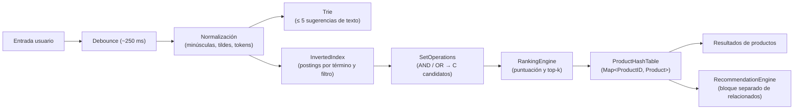

[← Volver al README principal](../../README.md)

# Motor de Búsqueda y Decisión de Usar Tablas Hash

> **Estado:** Diseño técnico planificado para la **Entrega final (3 de 3)** — todavía no está implementado en el código de la Entrega 2 de 3.

---

## 1. Propósito y decisión de diseño

El motor de búsqueda de **Mr. Patitas** se plantea como un **módulo independiente de la interfaz web**, encargado de resolver búsquedas por ID, texto y atributos, autocompletado mientras el usuario escribe, ordenamiento por relevancia y recomendaciones relacionadas.

### ¿Por qué elegimos Tablas Hash y un enfoque híbrido?
En un catálogo que puede crecer por encima del mínimo inicial de 20 artículos, recorrer un arreglo elemento por elemento en cada búsqueda ($O(n)$) obliga a inspeccionar todo el inventario cada vez que se consulta un producto o se combinan filtros. Para evitarlo y aplicar estructuras de datos propias de la carrera a escala académica, el diseño integra seis módulos coordinados:

1. **`ProductHashTable`:** acceso directo a productos por su identificador.
2. **`InvertedIndex`:** índices invertidos por atributo y por palabras clave.
3. **`SetOperations`:** combinación de filtros mediante intersección (`AND`), unión (`OR`) y eliminación de duplicados.
4. **`Trie`:** autocompletado por prefijo mientras el usuario escribe.
5. **`RankingEngine`:** puntuación determinista y explicable de resultados.
6. **`RecommendationEngine`:** sugerencia de productos similares o complementarios según sus atributos.

El objetivo no es replicar una plataforma comercial masiva ni montar un motor distribuido, sino aplicar principios claros de recuperación de información de forma incremental: primero `Hash + InvertedIndex + Set`, después `Trie`, y finalmente `Ranking` y `Recommendations`.

---

## 2. Modelo de producto y estructuras principales

### Modelo de referencia
```text
Product {
  id, name, normalizedName, category, species, brand,
  price, stock, available, tags, description
}
```
Los atributos definitivos se ajustarán al catálogo completo de la entrega final.

### 2.1 `ProductHashTable` (`Map<ProductID, Product>`)
- **Función:** recuperar el objeto completo de un producto a partir de su `ProductID` sin recorrer todo el catálogo. Centraliza las lecturas cuando el usuario abre el detalle de un producto o cuando el motor hidrata los identificadores devueltos por los filtros.
- **Complejidad:**
  - En una tabla hash convencional el acceso exacto es **$O(1)$ esperado** bajo una buena función de dispersión.
  - En JavaScript/TypeScript, la especificación de `Map` garantiza **acceso promedio sublineal**, no $O(1)$ estricto.
- **Comparación con arreglos pequeños:** con solo 20 productos, un recorrido lineal en un `Array` puede ser incluso más rápido en tiempo absoluto por tener menos *overhead* de memoria. La ventaja de las tablas hash y los índices invertidos se observa con claridad al escalar el catálogo (1.000, 10.000 y 100.000 productos).

### 2.2 `InvertedIndex`
- **Índice por atributos:** `Map<Field, Map<NormalizedValue, Set<ProductID>>>`
- **Índice textual:** `Token -> PostingList` (`Set<ProductID>`)
- **Ejemplos de entradas:**
  - `category / alimentación -> {P001, P002}`
  - `species / perro -> {P001, P003}`
  - `token / premium -> {P001}`
- **Complejidad:** consultar un término requiere acceder al índice y recorrer sus $p$ postings ($O(p)$). El espacio en memoria crece de forma proporcional al total de postings almacenados.
- **Rangos numéricos (precios):** una tabla hash exacta no sirve para consultas por rango (ej. precio entre \$20.000 y \$60.000); para eso se utiliza un índice ordenado o **B-tree** (disponible de forma nativa en PostgreSQL).

### 2.3 `SetOperations` (`AND` / `OR`)
- **`AND` (intersección):** devuelve los `ProductID` que cumplen todos los filtros activos. Para reducir comparaciones se parte siempre del **posting más pequeño ($p_{\min}$)** y se verifica pertenencia en los demás $q$ conjuntos, con un coste orientativo esperado de **$O(p_{\min} \cdot q)$**.
- **`OR` (unión):** une los postings y elimina duplicados con `Set`, con coste proporcional a la **suma de los tamaños de los postings**.
- **Precisión algorítmica:** no se debe afirmar que una búsqueda avanzada es $O(k)$ solo porque devuelve $k$ resultados; el coste real depende del tamaño de los postings y del número de candidatos procesados ($C$).

---

## 3. `Trie` y autocompletado

- **Estructura:** árbol de prefijos que almacena términos normalizados de nombres y consultas. Cada nodo guarda sus hijos en un `Map`, un marcador de fin de término y, opcionalmente, una lista acotada de sugerencias principales.
- **Complejidad:** ubicar un prefijo de longitud $m$ cuesta **$O(m)$ esperado**. Listar sugerencias depende del subárbol bajo ese prefijo; al limitar el desplegable a un máximo inicial de **5 sugerencias**, se define cómo seleccionar y mantener esas 5 entradas.
- **Comportamiento en la interfaz:** al escribir `"comi"`, el `Trie` puede sugerir `"comida para perro"` y `"comida para gato"`. Seleccionar una sugerencia completa el texto del buscador y dispara la búsqueda. Las sugerencias textuales se muestran separadas de las tarjetas de producto.

---

## 4. `RankingEngine` y `RecommendationEngine`

### 4.1 `RankingEngine`
Recibe los **$C$ candidatos únicos** filtrados y calcula un puntaje explicable:

$$\text{score} = w_1 \cdot \text{textMatch} + w_2 \cdot \text{attributeMatch} + w_3 \cdot \text{availability} + w_4 \cdot \text{popularity}$$

- Mientras no existan clics ni ventas reales, no se inventan métricas de comportamiento: el puntaje se apoya en coincidencia textual, coincidencia de atributos y disponibilidad (o datos sintéticos identificados como tales).
- **Complejidad:** puntuar $C$ candidatos cuesta **$O(C)$**, ordenarlos completamente **$O(C \log C)$**, y obtener solo los mejores $k$ con un *heap* cuesta **$O(C \log k)$**.

### 4.2 `RecommendationEngine`
- Enfoque basado en contenido (*content-based*) usando especie, categoría, etiquetas (*tags*) y reglas de productos complementarios. Para comparar etiquetas se puede usar la similitud de Jaccard:

$$\text{Jaccard}(A, B) = \frac{|A \cap B|}{|A \cup B|}$$

- **Complejidad:** comparar contra todo el catálogo cuesta aproximadamente **$O(n \cdot a)$** ($n$ productos, $a$ atributos), mientras que filtrar candidatos previos mediante `InvertedIndex` reduce el cálculo a **$C$ candidatos**.
- No corresponde a *collaborative filtering* ni a modelos de aprendizaje automático, ya que esos enfoques requieren historiales de interacción de múltiples usuarios.

---

## 5. Flujo de consulta, interfaz y servicios



- **Detalles de interfaz previstos:** separar el campo de búsqueda, las sugerencias textuales, los resultados de productos y el bloque de productos relacionados; manejar estados de carga, vacío y error; soporte de teclado (`Flechas`, `Enter`, `Escape`) con foco visible; debounce inicial de `250 ms` como valor de prueba y descarte de respuestas obsoletas.
- **Servicios previstos:** `suggest(query, limit)`, `search(query, filters, limit)` y `recommend(productId, limit)`.

---

## 6. Persistencia y consistencia con PostgreSQL

- Al incorporar el backend, **PostgreSQL** será la única fuente de verdad.
- `Map`, `Set`, `Trie` e índices en memoria funcionarán como estructuras derivadas reconstruibles desde la base de datos (carga inicial, actualización incremental, invalidación y reconstrucción ante fallos).
- El stock se validará siempre en el backend dentro de una transacción.
- `LocalStorage` no se utilizará para autenticación ni para inventario compartido.
- `JSON.stringify` no conserva `Map` ni `Set` como estructuras nativas; los datos se serializan como registros planos y los índices se reconstruyen al arrancar el servicio.

---

## 7. Pruebas y benchmarks previstos

- **Pruebas unitarias y de integración por implementar:** operaciones `get`/`set`/`update`/`delete` en `Map`, normalización de tildes y espacios, intersección `AND` y unión `OR`, prefijos y límites en `Trie`, ranking con desempates, recomendaciones excluyendo el producto actual y flujo completo desde escribir hasta abrir detalle.
- **Benchmark reproducible (pendiente de ejecución):** comparación controlada sobre conjuntos sintéticos de `20`, `1.000`, `10.000` y `100.000` productos en el mismo equipo, con calentamiento (*warm-up*) y varias repeticiones midiendo mediana, p95, memoria y tiempo de actualización entre:
  1. Arreglo lineal (`Array`).
  2. Tabla hash + índices invertidos.
  3. Motor híbrido completo (`Hash + InvertedIndex + Set + Trie + Ranking`).

---

## 8. Plan de implementación por etapas

1. **Etapa 1:** `ProductHashTable` + `InvertedIndex` + `SetOperations`.
2. **Etapa 2:** `Trie` para autocompletado por prefijo.
3. **Etapa 3:** `RankingEngine` determinista.
4. **Etapa 4:** `RecommendationEngine` por atributos y reglas complementarias.
5. **Ampliaciones futuras opcionales (solo si el proyecto lo requiere):** FST, búsqueda vectorial/HNSW, *collaborative filtering*, *Learning to Rank* o búsqueda distribuida.

---

**Ver también:** [Arquitectura y funcionamiento](./arquitectura.md) · [Guía de desarrollo](./guia-desarrollo.md) · [Requisitos y estado](./requisitos-y-estado.md)
